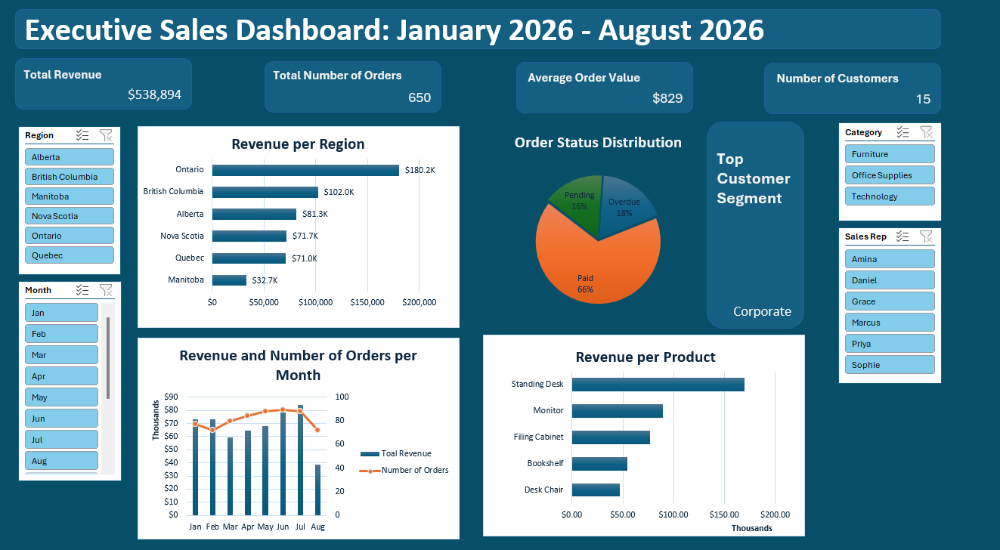
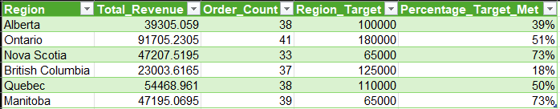
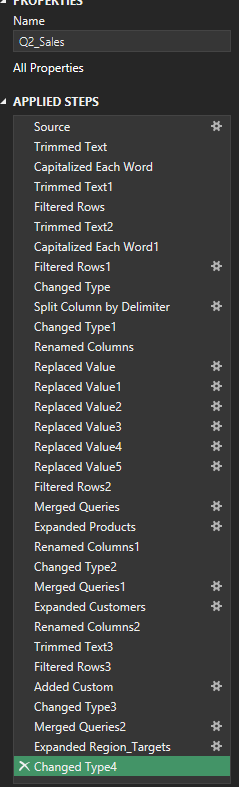

# Excel Business Data Analysis

Two practical Excel projects demonstrating sales performance analysis, executive reporting and repeatable data preparation using Power Query.

## Project 1 — Executive Sales Performance Analysis

### Business objective
Monitor sales performance, customer activity, product demand and payment status through an interactive executive dashboard.

### Approach
- Enriched sales records with customer and product reference data using XLOOKUP.
- Applied IF, IFERROR, SUMIFS and COUNTIFS for business logic and analysis.
- Built PivotTables, PivotCharts, slicers and KPI calculations to support interactive reporting.

### Executive dashboard

### Key metrics

| Metric | Result |
|---|---:|
| Total revenue | $538,894 |
| Orders | 650 |
| Average order value | $829.07 |
| Unique customers | 15 |
| Overdue orders | 116 (17.8%) |

### Business insights
- Ontario contributes approximately one-third of total revenue.
- Corporate customers are the largest segment by revenue.
- Standing desks are the leading product by revenue.
- Overdue orders warrant further investigation and targeted collection follow-up.

## Project 2 — Q2 Sales Data Preparation & Management Reporting

### Business objective
Consolidate April–June 2026 sales extracts into a repeatable reporting workflow and assess monthly, product category and regional performance.

### Power Query workflow
1. Append the three monthly sales extracts.
2. Standardize text, data types and geographic fields.
3. Merge customer, product and regional target reference tables.
4. Calculate revenue and produce monthly, category and regional summaries.
5. Refresh and reconcile reporting outputs.

### Results

| Month | Revenue | Sales records |
|---|---:|---:|
| April | $129,920.05 | 72 |
| May | $91,152.78 | 75 |
| June | $81,812.63 | 79 |
| Total | $302,885.46 | 226 |

All three refreshed summaries reconcile to the consolidated dataset's known revenue of $302,885.46. Totals are calculated before rounding.

### Business insights
- April generated the highest monthly revenue.
- Furniture contributed approximately 63% of known revenue.
- Ontario generated the highest regional revenue.
- Nova Scotia and Manitoba each achieved approximately 73% of their regional targets; no region reached its full target.

### Regional performance summary

### Power Query transformation steps

### Data quality and limitations
The final workbook retains five repeated order IDs and unmatched reference records. Counts represent sales records rather than distinct orders, and revenue totals reflect the saved data as provided; duplicate records may overstate revenue. Missing product pricing can result in null revenue. These exceptions should be resolved before using the report for operational decisions.

## Tools and skills
Microsoft Excel · Power Query · XLOOKUP · Conditional formulas · PivotTables · PivotCharts · Slicers · Data validation and reconciliation · KPI reporting · Business analysis

## How to explore
Open the included Excel workbooks to examine the dashboards, underlying datasets, formulas and reporting outputs. The repository also contains supporting project visuals. For the Power Query project, use Excel's Data > Queries & Connections to inspect the transformation steps.

These projects use practice datasets for portfolio demonstration.
